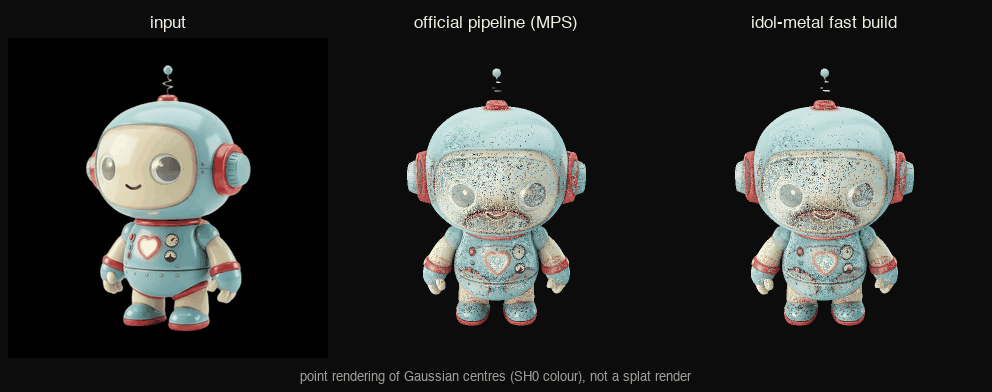
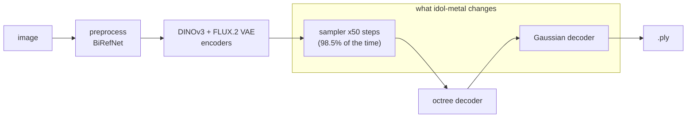
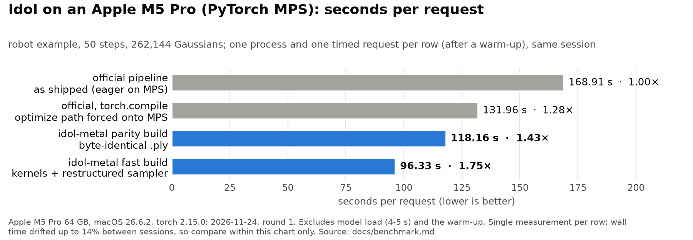
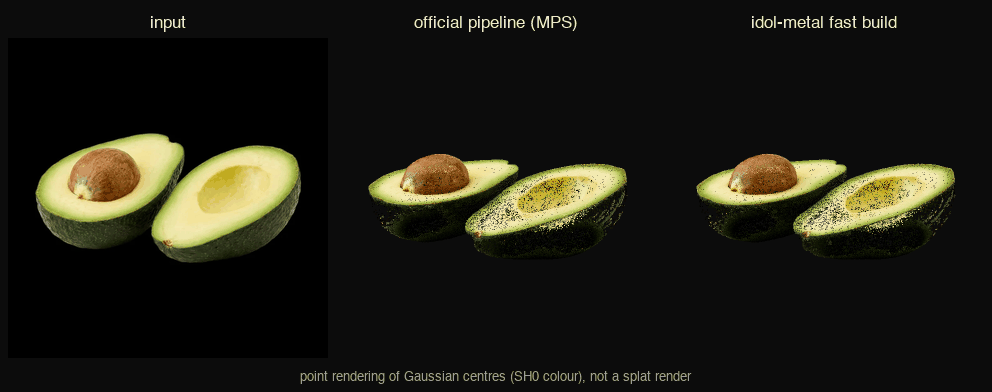
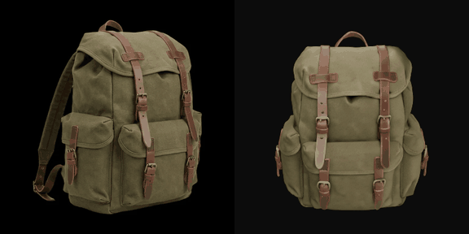

<h1 align="center">idol-metal</h1>

<p align="center">
  <b>One image in, a 3D Gaussian splat out, 1.75-2.00x faster than the official pipeline on an Apple M5 Pro.</b><br>
  An unofficial Apple-silicon port of Speri Labs' Idol: PyTorch MPS, a restructured sampler, fused Metal kernels, and a byte-identical parity build.
</p>

<p align="center">
  
  
  <a href="https://huggingface.co/speridlabs/idol"></a>
  <a href="https://huggingface.co/kernels/suvadityamuk/idol-metal"></a>
  
</p>

<p align="center">
  
</p>
<p align="center"><sub>Both 3D columns are .ply files written on the M5 Pro (official pipeline on MPS, and <code>scripts/infer.py</code>'s
fast build), drawn as <b>points</b>: each Gaussian's centre with its base colour. This is not a Gaussian-splat render;
there is no 3DGS rasterizer for MPS here (<code>tools/point_turntable.py</code>, CPU only).</sub></p>

```bash
python scripts/infer.py photo.jpg -o photo.ply
```

You get `photo.ply`, a standard 3D Gaussian splat file (262,144 Gaussians by default) that any 3DGS viewer opens,
including the sides the photo never showed.

## Why

[Idol](https://huggingface.co/speridlabs/idol) turns one picture of an object into 3D Gaussians. Its official pipeline
([idol-sdk](https://github.com/speridlabs/idol-sdk)) runs on Apple silicon through PyTorch's MPS backend, eagerly (its
`torch.compile` path is CUDA-only). 98.5% of a request is the sampler: 50 steps, two guidance passes each. idol-metal
keeps the official pre-processing, encoders and decoders, makes the sampler do less work and fuses its glue ops:

| Apple M5 Pro, robot example, 50 steps, 262,144 Gaussians | seconds per request | speed-up |
|---|---|---|
| official pipeline (as shipped: eager on MPS) | 168.9 | 1.00x |
| official pipeline with its `torch.compile` path forced onto MPS | 132.0 | 1.28x |
| **idol-metal fast build** | **96.3** | **1.75x** |
| idol-metal parity build (byte-identical `.ply`) | 118.2 | 1.43x |

One process per row, one timed request after a short warm-up, same session (round 1). Over the four benchmark configs
(two images, 262,144 and 1,048,576 Gaussians) the fast build is 1.75-2.00x faster than the official pipeline and
1.36-1.46x faster than its `torch.compile` path. Full tables, peak memory and the method:
[docs/benchmark.md](docs/benchmark.md).

**Tested on one machine only: an Apple M5 Pro (64 GB) with macOS 26.6.2 and PyTorch 2.15.0.** Nothing else was tested.

## Install

You need a Mac with Apple silicon and **macOS 26 or later** (the `linear_gelu` kernel uses Metal 4's
MetalPerformancePrimitives), Python 3.13, about 11 GB of free unified memory, and a Hugging Face account that has
accepted the licences of the two gated image encoders Idol uses,
[DINOv3](https://huggingface.co/facebook/dinov3-vith16plus-pretrain-lvd1689m) and
[FLUX.2-dev](https://huggingface.co/black-forest-labs/FLUX.2-dev) (only its VAE is downloaded).

```bash
git clone https://github.com/suvadityamuk/idol-metal && cd idol-metal
python3.13 -m venv .venv && . .venv/bin/activate
pip install -r requirements.txt        # torch 2.15.0, idol-sdk 8db7003, kernels 0.18.3, pinned
hf auth login                          # or export HF_TOKEN=...
```

The first run downloads Idol's weights (about 3 GB), the two encoders, and the idol-metal kernels for your torch version
from [suvadityamuk/idol-metal](https://huggingface.co/kernels/suvadityamuk/idol-metal) (version 1).

> [!NOTE]
> To use a local kernel build instead, build it once with kernel-builder (see [Development](#development)) and add
> `--local-kernels kernel`.

## Usage

```bash
python scripts/infer.py photo.jpg -o photo.ply                       # fast build, real-photo mode
python scripts/infer.py render.png -o render.ply --mode synthetic    # renders and generated images: tighter crop
python scripts/infer.py photo.jpg -o photo.ply --seed 7              # another take on the same image
python scripts/infer.py photo.jpg -o photo.ply --gaussians 1048576 --steps 50 --cfg 3.0
python scripts/infer.py photo.jpg -o photo.ply --local-kernels kernel    # kernels from a local kernel-builder build
python scripts/infer.py photo.jpg -o photo.ply --build parity        # byte-identical to the official pipeline*
python scripts/infer.py photo.jpg -o photo.ply --check other.ply     # byte-compare the result, exit 1 if different
```

\* on the tested setup; see [Quality](#quality).

It writes `photo.ply`, `photo_input.png` (the cropped, background-removed input) and `photo_camera.json`, and prints
where the kernels came from and the timings. The robot example on the M5 Pro (fast build, local kernels):

```
$ python scripts/infer.py fig-robot-cute.webp --mode synthetic -o robot_fast.ply --local-kernels kernel
device:  Apple silicon, MPS, macOS 26.6.2, torch 2.15.0
build:   fast (restructured sampler + idol-metal kernels)
kernels: local kernel-builder build kernel (kernels 0.18.3)
load:    4.3 s (weights, encoders)
request: 86.4 s (first request in this process: includes one-off shader compilation)
export:  0.04 s -> robot_fast.ply, robot_fast_input.png, robot_fast_camera.json
total:   92.4 s wall (including start-up and loading)
```

It stops with an explanation on a Mac without Apple silicon or MPS, on macOS older than 26, without a Hugging Face
login or without access to the gated encoders, and when the kernels cannot be loaded.

### From Python

`infer.py` is a thin wrapper; the same thing in your own code:

```python
from kernels import get_kernel                    # or get_local_kernel(Path("kernel"), trust_remote_code=True)
from idol import IdolPipeline
from fast import ops                              # run from the repository root
from fast.pipeline import install

ops.use_package(get_kernel("suvadityamuk/idol-metal", version=1, trust_remote_code=True))
pipe = IdolPipeline.from_pretrained("speridlabs/idol", device="mps")
install(pipe)                                     # install(pipe, ["parity"]) for the parity build
out = pipe("photo.jpg", mode="real", seed=42, steps=50, cfg_strength=3.0, num_gaussians=262144)
out.gaussian.save_ply("photo.ply")
```

## How it works



Everything outside the two marked stages is the official idol-sdk code, unmodified; idol-metal installs its sampler
and Gaussian-decoder forward into the official pipeline object.

- **Reuse that is exact.** The context stream depends only on the image, so it is computed once per request; the time
  embedding and the noise and camera refiners are computed once per step and shared by both guidance passes.
- **One context token in the unconditional pass** (fast build only). With the condition zeroed, its 4,101 context
  tokens are identical, so the pass carries one token whose attention key gets weight 4,101 through an fp16 bias.
  This is the only change that alters the arithmetic, and it is what the parity build switches off.
- **Fused Metal kernels** ([kernel/](kernel/), packaged as
  [suvadityamuk/idol-metal](https://huggingface.co/kernels/suvadityamuk/idol-metal)) that keep PyTorch's rounding points:
  residual + LayerNorm + adaLN + RePo LayerNorm (`resid_ln_mod`), RePo angles + RoPE + q/k RMSNorm (`repo_rope_qk`),
  fc1 GEMM with bias and GELU in the epilogue (`linear_gelu`, Metal 4 `matmul2d`), and four smaller ops. GEMMs and
  attention stay PyTorch's MPS kernels, which already run near the hardware rate.
- **Gaussian decoder** on the same kernels, bit-equal to the official one.

A fast step (both guidance passes) takes about 1.4 s against 2.9-3.0 s for the official pipeline. Every change and its
measured effect, including the rejected ones, is in [docs/ab-log.md](docs/ab-log.md); the profile that motivated them
is in [docs/profile.md](docs/profile.md).

## Optimizations: where the time went

The sampler is 98.5% of a request (150.9 s of 153.1 s), so that is where the work went. In one official forward,
attention and the matrix multiplies already run at the hardware rate; about 45% of the time is elementwise glue
around them (fp32 round trips, complex-number RoPE, separate norm, modulation and residual kernels). Per sampling
step (both guidance passes), robot, 262,144 Gaussians, fast build and official build interleaved in one process:

| step | what changed | fast vs official, ms per step | speed-up so far | error added |
|---|---|---:|---:|---|
| 1 | **Stop recomputing.** Context stream once per request; noise refiner, camera refiner and time embedding once per step, shared by both passes | 2,824 vs 2,898 | 1.03x | none (bit-equal) |
| 2 | **One context token in the unconditional pass.** Its 4,101 context tokens are identical, so attention sees one token with weight 4,101, carried by an fp16 key bias split over two copies of the token | 2,325 vs 2,984 | 1.28x | guided velocity rel. 7.8e-4 to 1.2e-3; conditional pass still bit-equal |
| 3 | **Fused Metal kernels** for the glue: residual + LayerNorm + adaLN + RePo LayerNorm in one pass; RePo angles + RoPE + q/k RMSNorm in one pass; in-place GELU | 1,604 vs 2,905 | 1.81x | none beyond step 2 |
| 4 | **fc1 multiply + bias + GELU in one Metal 4 `matmul2d` kernel** (3.25 vs 4.09 ms per call) | 1,910 vs 1,982 with the fusion off | 1.04x on top | none (bit-equal) |
| 5 | **Kernels loaded as the packaged build** instead of runtime-compiled shaders | 1,576 vs 1,649 | 1.05x on top | none (bit-equal) |

Steps 1, 3, 4 and 5 change no bits; only step 2 does, and the parity build is the fast build without it (2,112
against 3,023 ms per step, 1.43x, byte-identical output). Running steps back to back, a fast step takes 1,405 ms;
the estimated floor with the stock attention and matrix multiplies is about 1,250 ms.

Outside the sampler, the **Gaussian decoder** runs on the same kernels, bit-equal: 476 against 631 ms at 262,144
Gaussians (1.33x), 4,907 against 5,284 ms at 1,048,576 (1.08x).

Tried and dropped, with the measurement:

| idea | result |
|---|---|
| fp32 mask for the one-token pass | 7,914 ms per step (0.35x): an fp32 mask falls off the fast attention kernel (253 vs 11.5 ms per call) |
| `torch.compile` of the restructured blocks instead of hand kernels | 1,761 ms per step: slower than 1,604 and less close |
| Re-tuned attention tiles | best 21.86 against 21.61 ms: nothing beyond noise |
| Hand-written matrix multiply | 31.8 against 31.9 TFLOP/s: no gain alone, useful only to fuse the GELU |

## Benchmark

<picture>
  <source media="(prefers-color-scheme: dark)" srcset="assets/benchmark-dark.png">
  
</picture>

Total seconds per request (image path in, Gaussians out; load, warm-up and the PLY write excluded), with peak process
memory footprint:

| config | official | official, `torch.compile` | parity | fast |
|---|---|---|---|---|
| robot 262k, round 1 | 168.9 (10.4 GB) | 132.0 (10.5 GB) | 118.2 (10.0 GB) | **96.3 (10.4 GB), 1.75x** |
| robot 262k, round 2 | 175.4 | 139.0 | 122.3 | **94.9, 1.85x** |
| avocado 262k | 174.6 | 133.8 | 124.4 | **98.1, 1.78x** |
| robot 1M | 185.2 | 143.2 | 126.2 | **98.5, 1.88x** |
| avocado 1M \* | 165.8 | 120.6 | 107.6 | **82.8 (11.0 GB), 2.00x** |

Apple M5 Pro, 64 GB, macOS 26.6.2, PyTorch 2.15.0, idol-sdk 8db7003; seed 42, 50 steps, cfg 3.0. One process per row,
order flipped between rounds and images, one measurement per row. \* Ran later in a cooler state of the machine: compare
within that row only. Wall time drifted by up to 14% between sessions, so compare within a row. Peak memory is about
the same as the official pipeline's. Model load is 4.2-5.0 s for every variant. Chart data:
[assets/bench_metal.json](assets/bench_metal.json), drawn by `tools/make_charts.py`.

## Quality

**Parity build.** On the tested setup (M5 Pro, macOS 26.6.2, PyTorch 2.15.0, idol-sdk 8db7003), its `.ply` is
byte-identical (sha256) to the official pipeline's on MPS on all four fixed configs: the robot (synthetic) and avocado
(real) examples, at 262,144 and 1,048,576 Gaussians, seed 42, 50 steps, cfg 3.0. The official pipeline is itself
deterministic on MPS (two fresh runs give the same bytes). On another Mac, macOS or PyTorch version, MPS may pick
different kernels and the bytes can differ; that was not tested. `tools/parity_check.sh` is the regression check.

**Fast build.** It is not byte-identical; it is held to the official pipeline's own spread, measured as how far the
official `torch.compile` path is from the official eager output:

| config | fast build: latent rel. L2 / Chamfer | official `torch.compile`: latent rel. L2 / Chamfer |
|---|---|---|
| robot 262k | **1.02e-2 / 1.72e-3** | 3.69e-2 / 1.78e-3 |
| avocado 262k | **6.13e-3 / 1.76e-3** | 7.58e-3 / 1.76e-3 |
| robot 1M | **- / 1.02e-3** | - / 1.08e-3 |
| avocado 1M | **- / 1.10e-3** | - / 1.10e-3 |

"Latent" is the sampled latent before decoding; Chamfer is the mean nearest-neighbour distance between Gaussian
centres, both ways, with the object inside [-0.5, 0.5]^3. The fast build is inside the official spread on every metric
measured. Rendered-view PSNR/SSIM was not measured (no 3DGS rasterizer on MPS).

<p align="center">
  
</p>
<p align="center"><sub>Avocado (real-photo mode), 262,144 Gaussians, both from this Mac, drawn as points as above.</sub></p>

For a picture of what Idol's splats look like when properly rendered, here are two turntables **rendered with gsplat
from the CUDA port's output on an NVIDIA H200** ([idol-cuda](https://github.com/suvadityamuk/idol-cuda)). They
illustrate the model, not this backend's output:

<p align="center">
  
  
</p>

## Limits and what is untested

- **One machine:** Apple M5 Pro, 64 GB, macOS 26.6.2, PyTorch 2.15.0. No other Apple GPU, macOS or PyTorch version was
  tested. macOS 26+ is required for the `linear_gelu` kernel (Metal 4).
- **Kernel variants:** the package is built for torch 2.10 to 2.15; only the torch 2.15 variant was loaded and tested.
- **Kernels from the Hub:** checked after publishing with `kernels` 0.18.3 on the same machine: the 34 kernel tests
  pass on the Hub copy, and `infer.py --build parity` with the Hub kernels wrote a `.ply` byte-identical to the
  official pipeline's (robot, 262,144 Gaussians). The benchmark and the other checks above used
  `--local-kernels kernel` (the same build, loaded through `get_local_kernel`).
- **The native runner is experimental.** `scripts/run_native.sh` runs only the sampling loop natively (an
  Objective-C++/Metal binary); the front end and the decoders are still Python, it needs PyTorch 2.15's metallib
  (`metal_40.metallib`, not shipped here; how to obtain it is not documented yet) for attention, and it has **no parity
  mode** (its glue ops are within 5.5e-4 relative of PyTorch per step, not bit-equal).
- Rendered-view quality metrics were not measured.

## FAQ

<details>
<summary><b>Does it work on M1/M2/M3/M4?</b></summary>

Untested. It needs macOS 26 or later for Metal 4; whether the fused `linear_gelu` kernel runs and how fast it is on
other Apple GPUs was not measured. The parity build's byte-identity is only claimed for the tested M5 Pro setup.
</details>

<details>
<summary><b>Is the output the same as the official pipeline's?</b></summary>

The fast build's is close, not identical: closer to the official eager output than the official `torch.compile` path
is (see Quality). The parity build's is byte-identical on the tested setup. Same seed, same starting noise.
</details>

<details>
<summary><b>How much memory does it need?</b></summary>

The peak process footprint was 10.0-11.0 GB in the benchmark, about the same as the official pipeline's 10.4 GB.
</details>

<details>
<summary><b>Why do I need a Hugging Face token?</b></summary>

Idol encodes the image with DINOv3 and the FLUX.2-dev VAE, which are gated. Accept their licences on the Hub with your
account and log in. Nothing is uploaded anywhere; the request runs on your Mac.
</details>

<details>
<summary><b>Is there an MLX version?</b></summary>

Yes, a sibling port: [idol-mlx](https://github.com/suvadityamuk/idol-mlx), measured on the same Mac. Its fast build is
about as fast as this one (0.98-1.04x of it, within drift) and uses more memory (12.2-12.4 GB). There is also a CUDA
port, [idol-cuda](https://github.com/suvadityamuk/idol-cuda).
</details>

<details>
<summary><b>Can I use the kernels on their own?</b></summary>

Yes: `get_kernel("suvadityamuk/idol-metal", version=1, trust_remote_code=True)`. The ops and their
contracts are on the [kernel card](kernel/CARD.md). They are specific to Idol's shapes (width 1024, head dimension 64).
</details>

## Development

| path | what |
|---|---|
| `fast/` | the fast build: `dit.py` (restructured sampler), `decoder.py` (Gaussian decoder), `ops.py` (kernel wrappers), `pipeline.py` (installs both into the official pipeline) |
| `kernel/` | kernel-builder project (edition 6, `cpp-metal`): `idol_metal/idol_kernels.metal`, `ops.mm`, 34 tests, `benchmarks/`, CARD.md |
| `native/` | experimental native sampler (`idol_sample`, Objective-C++/Metal) and its kernel test |
| `scripts/` | `infer.py`, `run_kernels.py` (older flags), `run_native.sh` (experimental) |
| `tools/` | reference runner, variant runner, A/B tools, closeness, benchmark driver, parity check, charts, point turntables |
| `docs/` | profile, A/B log, benchmark |
| `logs/` | small raw outputs the docs cite (benchmark rows, closeness JSON, script checks) |

```bash
# kernels: build with kernel-builder (Nix), check, test on the GPU
cd kernel && kernel-builder build-and-copy -L . && kernel-builder check-builds .
IDOL_KERNEL_LOCAL_PATH=$PWD python -m pytest tests && cd ..
# then
python scripts/infer.py photo.jpg -o photo.ply --local-kernels kernel
```

The development scripts in `tools/` expect the official idol-sdk checkout next to this repository
(`../reference/idol-sdk`), as it was during the port. The full write-up, with every number and what was and was not
verified, is [REPORT.md](REPORT.md).

## Credits

- [Idol](https://huggingface.co/speridlabs/idol) and [idol-sdk](https://github.com/speridlabs/idol-sdk) by Speri Labs
  (Apache-2.0). This port reuses idol-sdk's modules and is derived from its code; see [NOTICE](NOTICE). It is not
  affiliated with Speri Labs.
- Image encoders: [DINOv3](https://huggingface.co/facebook/dinov3-vith16plus-pretrain-lvd1689m) (Meta) and the
  [FLUX.2-dev](https://huggingface.co/black-forest-labs/FLUX.2-dev) VAE (Black Forest Labs), gated under their own
  licences.
- Parts of the Metal kernels mirror PyTorch's MPS kernels (BSD-3-Clause). Packaging with kernel-builder and Hugging
  Face [kernels](https://github.com/huggingface/kernels).
- Sibling ports: [idol-cuda](https://github.com/suvadityamuk/idol-cuda), [idol-mlx](https://github.com/suvadityamuk/idol-mlx).
- README layout after [cfahlgren1/idol-mlx](https://github.com/cfahlgren1/idol-mlx).

Licence: Apache-2.0 ([LICENSE](LICENSE)).
